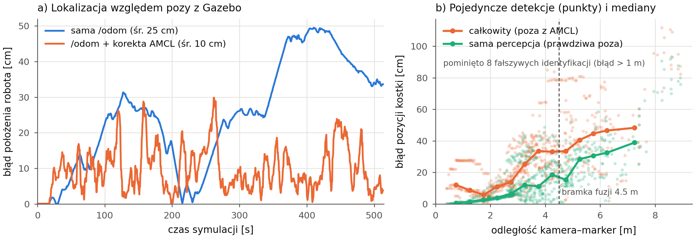

# Lab 05 – Robot poszukujący (`cube_search`)

TurtleBot3 waffle w symulacji `arm_house` (ROS 2 Jazzy, Gazebo, Nav2 + AMCL) **autonomicznie przeszukuje znane
mieszkanie i znajduje 5 kostek z tagami ArUco**. Wynikiem akcji `/search_cubes` są ID kostek i ich pozycje w ramce `map`.

Kostki są za niskie dla lidaru, więc widać je tylko kamerą. Dlatego eksploracja kończy się wtedy, gdy **kamera
(stożek 45°, 3.5 m) obejrzała wymagany procent wolnej przestrzeni**, a nie wtedy, gdy mapa lidaru jest kompletna.

Raport (1 strona A4): [`raport/raport.pdf`](raport/raport.pdf), źródła: `raport/raport.html` i `raport/raport.tex`.

## Uruchomienie

Wymagania: Docker oraz obraz z [Dockerfile](Dockerfile) (ROS 2 Jazzy, Nav2, TurtleBot3, `arm05_sim`).

```bash
# host: zbudowanie obrazu i start kontenera ARM_05 (jednorazowo)
bash arm_05_build.sh
bash arm_05_run_gpu_nvidia.sh

# host: skopiowanie pakietów do kontenera, colcon build i testy jednostkowe
./deploy.sh --test
```

W kontenerze każdy terminal otwieramy przez `docker exec -it ARM_05 bash`, a następnie `export ROS_DOMAIN_ID=67`:

```bash
ros2 launch arm05_sim world.launch.py           # 1: symulacja + Nav2 + AMCL
ros2 launch cube_search cube_search.launch.py   # 2: aruco_detector + search_server + explore_lite
ros2 run cube_search search_client              # 3: start; --expected 0 = szukaj do 95% pokrycia
```

Zamiast klienta można wysłać cel bezpośrednio:
`ros2 action send_goal /search_cubes cube_search_interfaces/action/SearchCubes "{expected_cubes: 5}" --feedback`.
Topiki do podglądu w RViz: `/cube_search/coverage_map` (Map), `/cube_search/cubes` (MarkerArray) i `/cube_search/debug_image`.

Ewaluację względem Gazebo uruchamia `ros2 launch cube_search evaluation.launch.py`, a wykresy:
`python3 tools/plot_eval.py <katalog_csv> <wyjście>` oraz `python3 tools/plot_cube_error.py <katalog_csv> <wyjście>`.

## Jak to działa

```
/camera/image_raw ─► aruco_detector ──/cube_search/detections──► cube_search_server ◄── goal: /search_cubes
/odom, TF (AMCL)  ─┘   (ArUco + solvePnP)                         │  mapa pokrycia kamery
                                                                  ├─/cube_search/coverage_map─► explore_lite ─► Nav2 ─► /cmd_vel
                                                                  └─ obroty 360° ───────────────────────────────────► /cmd_vel
```

Pozycja kostki = `T_map_odom (AMCL) · T_odom_base (/odom na stemplu obrazu) · T_base_cam (tf_static) · T_cam_marker (solvePnP)`,
następnie przesunięcie o 4.5 cm w głąb kostki.

### Autorskie node'y (pakiet `cube_search`)

| Node | Rola |
|---|---|
| `aruco_detector` | Wykrywa markery (`DICT_ARUCO_ORIGINAL`, bok 7.01 cm) z częstotliwością ok. 5 Hz. Liczy pozę markera przez `solvePnP` (IPPE_SQUARE) i sprawdza błąd reprojekcji. Pozycję środka kostki przelicza do ramki `map`. Publikuje `/cube_search/detections`. |
| `search_server` | Serwer akcji `/search_cubes`. Prowadzi mapę pokrycia kamery (ray casting po mapie) i przekazuje ją do explore_lite jako „nieznane = niewidziane kamerą”. Na starcie wykonuje obrót 360°. Łączy obserwacje każdej kostki (mediana, odrzucanie odstających, potwierdzenie po ≥ 3 obserwacjach). Kończy pracę po znalezieniu N kostek, po osiągnięciu pokrycia lub po przekroczeniu limitu czasu. Feedback: stan, pokrycie i znalezione ID. |
| `search_client` | Wysyła cel akcji i wypisuje tabelę wyników z błędem względem pozycji kostek z Gazebo. |
| `pose_error_logger` | Narzędzie ewaluacyjne. Porównuje lokalizację (`/odom` oraz `/odom` + AMCL) i każdą detekcję z pozami z Gazebo, wyniki zapisuje do CSV. |

Interfejsy (pakiet `cube_search_interfaces`): akcja `SearchCubes` (goal: `expected_cubes`, `coverage_goal`, `timeout`)
oraz wiadomości `Cube`, `CubeDetection` i `CubeDetectionArray`. Eksploracja korzysta z gotowego
[m-explore-ros2](https://github.com/robo-friends/m-explore-ros2) (explore_lite). `deploy.sh` pobiera go automatycznie.


## Wyniki (symulacja)

| Przebieg | Kryterium stopu | Znalezione | Czas (sym.) | Pokrycie | Błąd pozycji kostek: śr. / maks. |
|---|---|---|---|---|---|
| [`przebieg_expected5.log`](raport/logi/przebieg_expected5.log) | 5 kostek | 5/5 | 335 s | 80.6 % | 12.0 / 21.2 cm |
| [`pomiar/wynik_akcji.log`](raport/logi/pomiar/wynik_akcji.log) | 95 % pokrycia | 5/5 | 494 s | 95.0 % | 12.1 / 23.6 cm |

W drugim przebiegu fałszywe ID (5 i 1023) zostały odrzucone przez fuzję.



Wnioski z pomiaru względem pozy z Gazebo (514 s):
- **Lokalizacja:** sama odometria daje średni błąd 24.7 cm (maks. 49.5 cm), który rośnie z czasem. Z korektą AMCL
  średni błąd spada do 9.5 cm (maks. 29.9 cm).
- **Detekcja:** z bliska (< 2 m) sama kamera myli się o ok. 2 cm, a większość błędu kostki pochodzi z lokalizacji
  robota. Powyżej 3 m rośnie błąd odległości z `solvePnP` (mediana 15–26 cm), bo marker zajmuje w obrazie zbyt mało pikseli.
- **Kierunki poprawy:** mniejsze okno doprecyzowania narożników, bramka fuzji ok. 3 m oraz triangulacja kostki
  z wielu klatek. Szczegóły są w raporcie.

## Struktura

```
src/cube_search/              node'y, launch, config/params.yaml, testy (pytest)
src/cube_search_interfaces/   akcja i wiadomości
tools/                        wykresy z ewaluacji
raport/                       raport (HTML/LaTeX/PDF), wykresy, logi z przebiegów
deploy.sh                     kopiowanie do kontenera + build (+ testy)
Dockerfile, arm_05_*.sh       obraz i kontener ARM_05
```
